# tde-ai-client

An AI client for the [Trinity Desktop Environment](https://www.trinitydesktop.org) (TDE).
Chat with AI models, attach files, generate images and have text read aloud, from a
native TDE/TQt application.

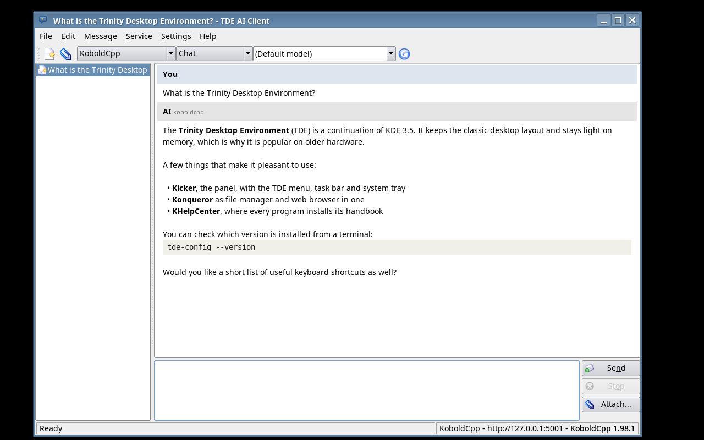

## Services

| | AI Horde | KoboldCpp | OpenAI-compatible |
|---|---|---|---|
| Where | free cloud service run by volunteers ([aihorde.net](https://aihorde.net)), no account needed | your own computer or LAN | any cloud service or server with the OpenAI API (OpenAI, OpenRouter, Mistral, Groq, Ollama, llama.cpp, LocalAI ...) |
| Chat | yes (queued) | yes (streamed) | yes (streamed) |
| Text files | yes | yes | yes |
| Images in | yes, described by the Horde's captioning workers first | with a vision model | if the model can see |
| Audio in | no | with a Whisper or audio model | directly, or transcribed first |
| Video in | no | no | if the model can watch |
| Other files (PDF ...) | no | no | if the service accepts them |
| Image generation | yes, also from an image | with an image model, also from an image | if the service offers it |
| Text to speech | no | with a speech model | if the service offers it |

What KoboldCpp can do is detected from the server. OpenAI-compatible servers cannot
be asked, so everything is offered and the server's error is shown if it refuses.
Video *generation* is not implemented.

## Features

- Conversations are saved automatically, listed in a side bar, and can be renamed,
  deleted and exported as HTML or plain text
- Attach files with the file dialog, drag and drop, paste, or on the command line
- Answers are streamed as they are written; stop them or ask again
- Model list fetched from the service; any model name can be typed
- Queue position, kudos and server version in the status bar
- API keys in the configuration file (mode 0600) or in TDEWallet
- Uses TDE's network layer (tdeio): the desktop's proxy and TLS settings apply
- Handbook for KHelpCenter (`help:/tde-ai-client`) and a man page

> Everything you type and attach is sent to the service you select. With the AI
> Horde that is a volunteer's computer; with a cloud service, the company running it.

## Screenshots

| | |
|---|---|
| 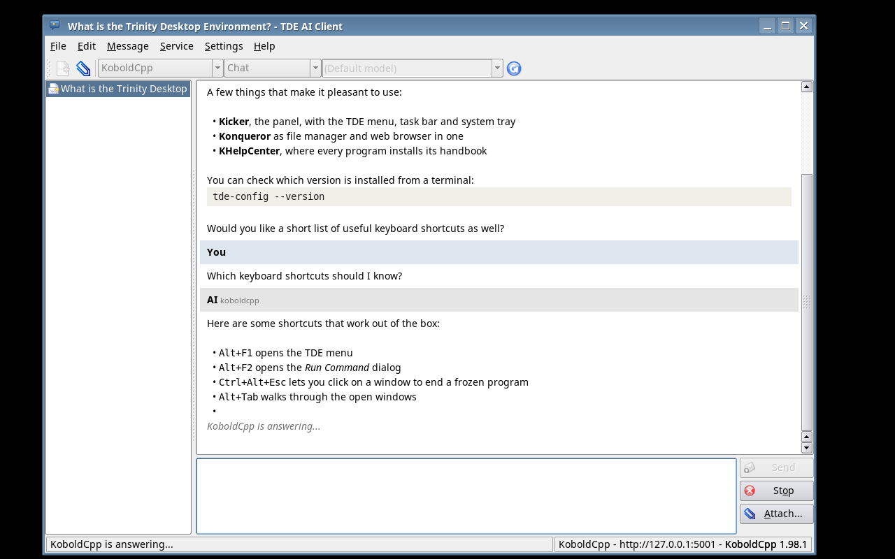 An answer while it is written | 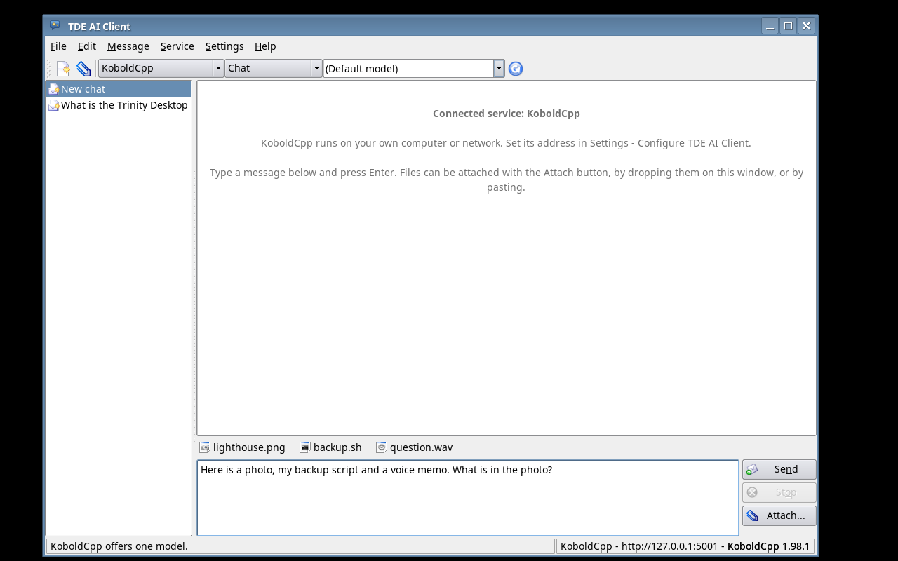 Files attached to a message |
| 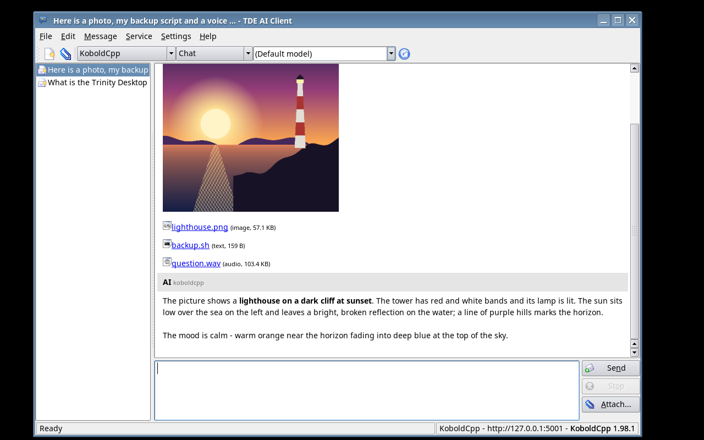 Image, script and recording sent to KoboldCpp | 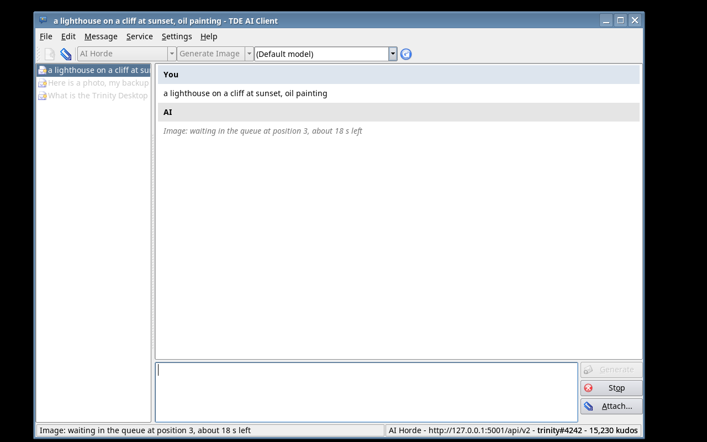 Waiting in the AI Horde queue |
| 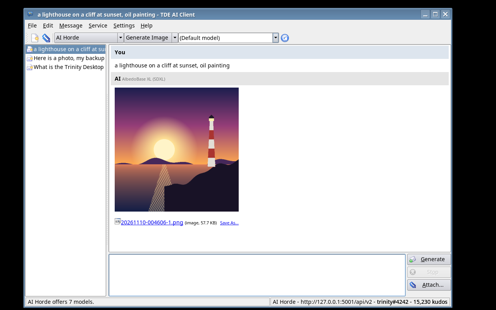 Image generation | 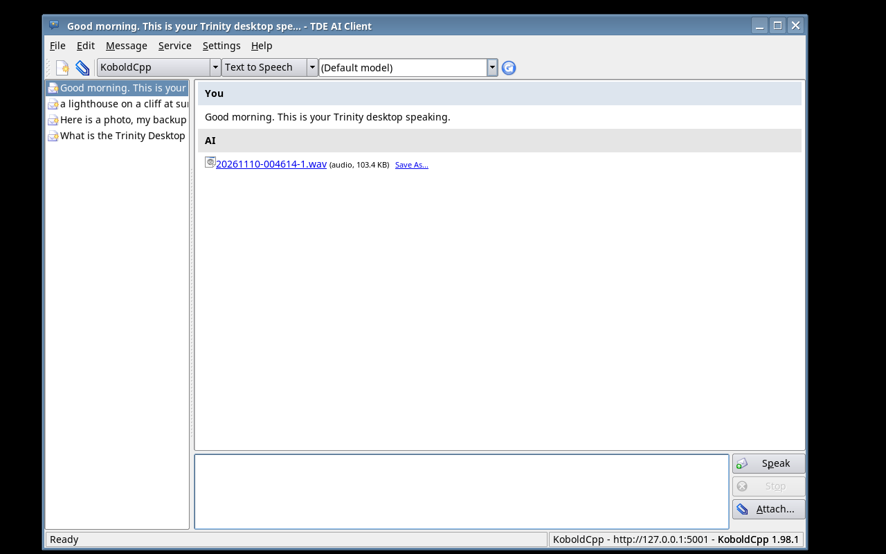 Text to speech |
| 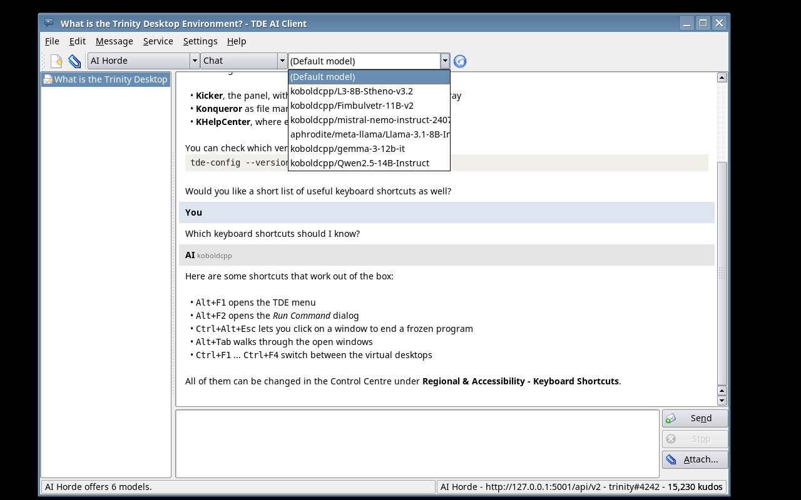 Models offered by the AI Horde | 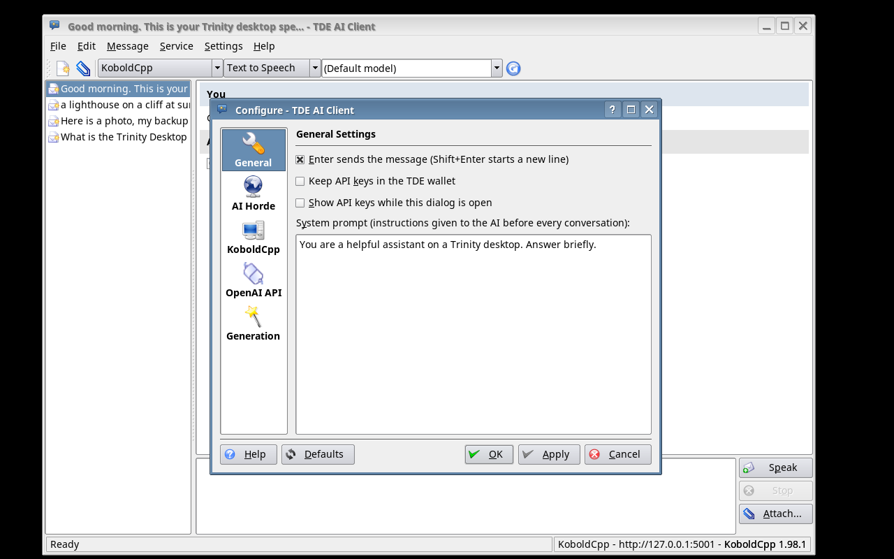 General settings |
| 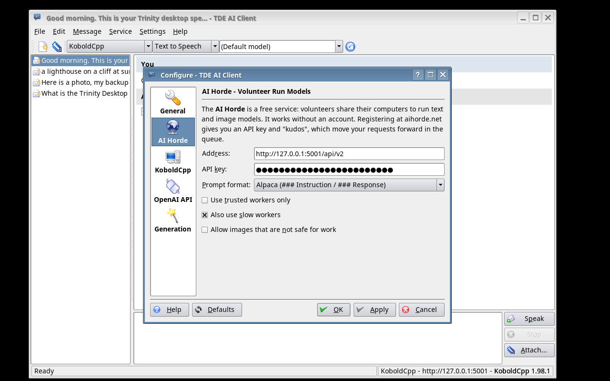 | 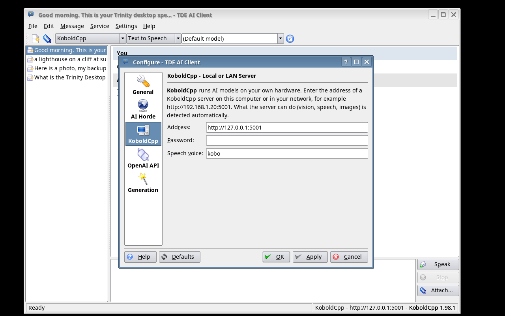 |
| 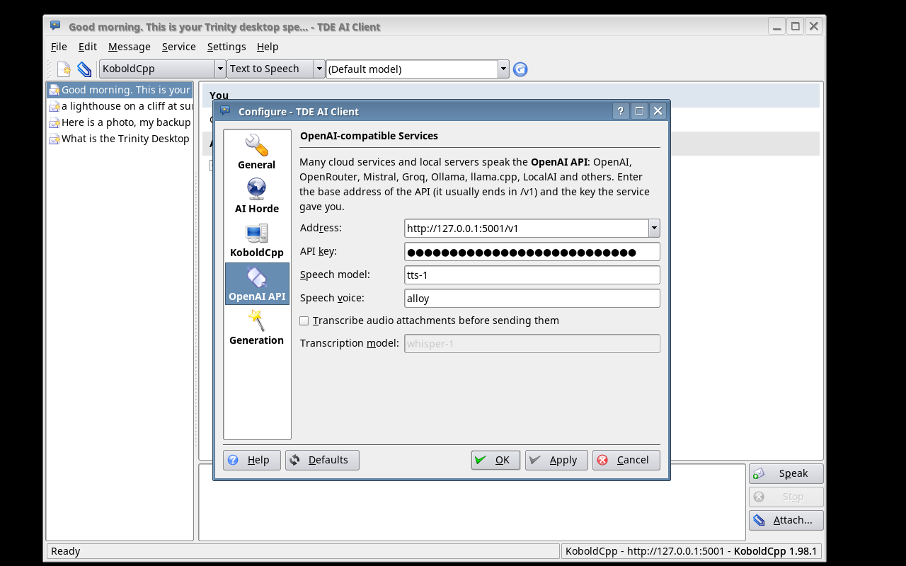 | 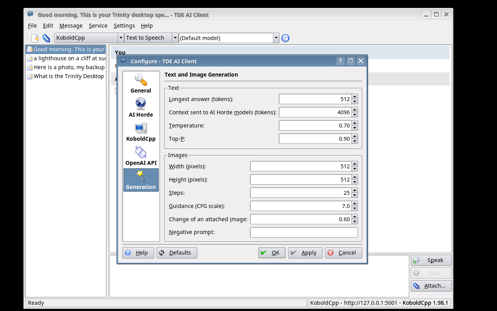 |
| 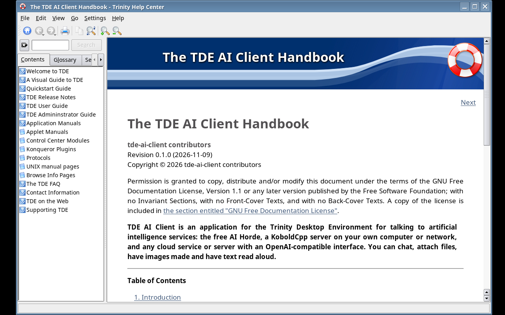 The handbook in KHelpCenter | |

The program in the screenshots is real; the AI is not. They are taken by
`tools/screenshots/take-screenshots.sh` against `tools/screenshots/mock-server.py`,
which imitates the three kinds of service with canned answers, a drawn picture and
a short melody, so that they can be reproduced without a GPU or an account.

## Install

Debian packages for **trixie** and **bookworm** are built by the GitHub Action in
`.github/workflows/build-deb.yml` (artifacts of each run; attached to releases for
`v*` tags). They need the [TDE R14.1 repository](https://wiki.trinitydesktop.org/DebianInstall).

```sh
sudo apt install ./tde-ai-client_0.1.0_amd64_trixie.deb
```

## Build from source

```sh
sudo apt install build-essential cmake tde-cmake tdelibs14-trinity-dev \
                 libtqt3-mt-dev tqt3-dev-tools libtqtinterface-dev
mkdir build && cd build
cmake .. -DCMAKE_INSTALL_PREFIX=/opt/trinity
make
sudo make install
```

Or build the package: `dpkg-buildpackage -us -uc -b`. `tools/Dockerfile` describes a
container with everything needed.

## Use

```sh
tde-ai-client                                         # last used service
tde-ai-client -b koboldcpp -p "What is this?" photo.jpg
tde-ai-client -b horde -m image -p "a lighthouse at sunset, oil painting"
```

The AI Horde works out of the box. For KoboldCpp or an OpenAI-compatible service,
enter the address (and key) in *Settings → Configure TDE AI Client*. See the
handbook (F1) or `man tde-ai-client`.

To try the program without any service:

```sh
python3 tools/screenshots/mock-server.py &     # then use http://127.0.0.1:5001 as
                                               # KoboldCpp address, .../api/v2 for the
                                               # Horde and .../v1 for the OpenAI API
```

## Disclaimer

This program was largely written with the help of an AI coding assistant ("vibe
coded"). It is provided as is, without any warranty. It is not affiliated with the
AI Horde, KoboldCpp, OpenAI or any other service it can connect to.

## License

GPL-2.0-or-later, see [COPYING](COPYING). The handbook is under the GNU FDL.
